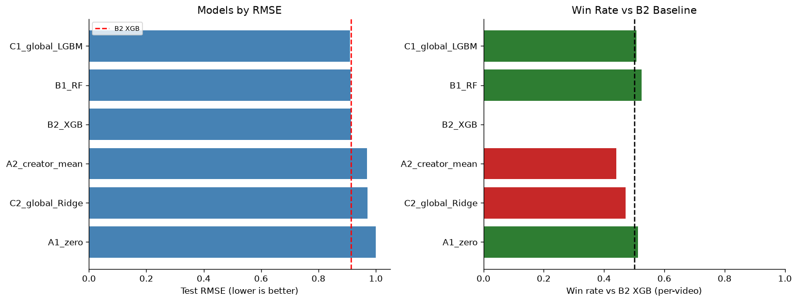
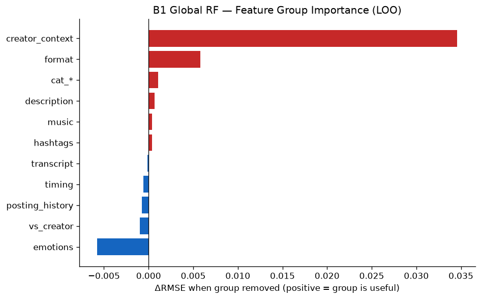

# Personalized Analysis of Creator Performance with Explainable ML

[](https://github.com/Shopska/Personalized_analysis_of_social_media/actions/workflows/lint.yml)

Semester project for the **Artificial Intelligence** course, Faculty of Applied Sciences, Ukrainian Catholic University (2026).

**Team:** Olha Kaplysh · Anastasiia Shopska

## The problem

Analytics tools for creators (vidIQ, TubeBuddy, TikTok Creative Center) learn from thousands of creators at once and give the same generic advice to everyone. But what works for one creator may not matter for another: niches, styles and audiences differ.

We want to predict how well a creator's video will perform **compared to that creator's usual level**, and explain *why* with SHAP, so a creator gets concrete, personal advice on what to change.

## Approach

1. **Relative target.** We predict `log1p(views at day 14)` minus the creator's own median. This removes "big account vs small account" and leaves the effect of the video itself.
2. **Global baseline models** trained on all creators together (Random Forest, XGBoost, LightGBM, Ridge).
3. **Per-creator models** trained on each creator's own history, compared against the global baseline. *(after the midterm)*
4. **SHAP** to explain predictions, and optionally an LLM layer that turns SHAP output into plain-language advice.

## Project status

| Stage | Status |
|---|---|
| Data loading and cleaning | ✅ done |
| EDA and target selection | ✅ done |
| Feature engineering (106 features, leakage-checked) | ✅ done |
| Global baseline models + comparison | ✅ done |
| Feature group ablation | ✅ done |
| Per-creator models vs global baseline | ⏳ after midterm |
| SHAP analysis per creator | ⏳ after midterm |
| LLM recommendations + demo app | ⏳ after midterm (optional) |

## Data

[`lingbow/tiktok-video-engagement-200k`](https://huggingface.co/datasets/lingbow/tiktok-video-engagement-200k) on Hugging Face (CC-BY-NC-4.0), three tables:

- `videos`: 209,543 videos with metadata and AI-extracted content features (summary, topic, emotion scores, music source)
- `creator_daily`: daily account snapshots (followers, likes, video count)
- `engagement_daily`: daily view/like/comment counts per video

After cleaning and keeping creators with ≥ 30 videos: **200,616 videos from 1,437 creators**. The train/test split (80/20) is stratified by creator, so every creator appears in both, which per-creator models will need.

Raw data is not stored in git; `scripts/download_data.py` downloads it.

## Key findings so far

- **Day 14 is the right target point.** By day 14 a video has a median 95.7% of its final views, and day-14 data covers 100% of videos (day 30 covers only 35%).
- **The creator explains most of the views.** `author_id` alone explains 73% of the variance in absolute views. That's why we use a relative target.
- **Feature effects differ between creators** (e.g. video duration helps some creators and hurts others). This motivates per-creator models.
- **Leakage control:** features use only data available before publication; precomputed text statistics were dropped because their missingness depends on the collection date, not the content.

## Results (test set, relative target)

| Model | RMSE ↓ | MAE ↓ | R² ↑ | Spearman ↑ |
|---|---|---|---|---|
| C1 · LightGBM | **0.910** | 0.584 | **0.154** | 0.320 |
| B1 · Random Forest | 0.911 | **0.579** | 0.153 | **0.326** |
| B2 · XGBoost | 0.913 | 0.585 | 0.150 | 0.310 |
| A2 · Creator mean (trivial) | 0.969 | 0.634 | 0.042 | 0.076 |
| C2 · Ridge | 0.972 | 0.618 | 0.036 | 0.142 |
| A1 · Predict 0 (trivial) | 1.000 | 0.603 | −0.021 | — |

- All three tree models beat the trivial baselines by ~0.09 RMSE and are within 0.002 of each other.
- R² ≈ 0.15 is expected: the relative target already removes the creator effect, and the remaining signal is about the content of a single video, which is much harder to predict.
- **Ablation:** the account context group (followers, likes, growth) carries most of the signal; removing the emotion features *improves* test RMSE (0.913 → 0.906). We will audit the account context features for leakage before relying on them.

<p align="center">
  
  
</p>

Full experiment log: [`results/experiments.md`](results/experiments.md) · metrics: [`results/leaderboard.csv`](results/leaderboard.csv)

## Notebooks

| # | Notebook | What it does | |
|---|---|---|---|
| 01 | [Data exploration](notebooks/01-data-exploration.ipynb) | Audit of the three tables, nulls, distributions | [](https://colab.research.google.com/github/Shopska/Personalized_analysis_of_social_media/blob/main/notebooks/01-data-exploration.ipynb) |
| 02 | [Target selection](notebooks/02-target-selection.ipynb) | Day 14 and relative target | [](https://colab.research.google.com/github/Shopska/Personalized_analysis_of_social_media/blob/main/notebooks/02-target-selection.ipynb) |
| 03 | [Feature engineering](notebooks/03-feature-engineering.ipynb) | 106 features in 14 groups, leakage checks | [](https://colab.research.google.com/github/Shopska/Personalized_analysis_of_social_media/blob/main/notebooks/03-feature-engineering.ipynb) |
| 04 | [Baseline models](notebooks/04-baseline-models.ipynb) | Trivial baselines, global RF and XGBoost, first SHAP plot | [](https://colab.research.google.com/github/Shopska/Personalized_analysis_of_social_media/blob/main/notebooks/04-baseline-models.ipynb) |
| 05 | [Alternative models](notebooks/05-alternative-models.ipynb) | Global LightGBM and Ridge | [](https://colab.research.google.com/github/Shopska/Personalized_analysis_of_social_media/blob/main/notebooks/05-alternative-models.ipynb) |
| 06 | [Model comparison](notebooks/06-model-comparison.ipynb) | Leaderboard and significance tests | [](https://colab.research.google.com/github/Shopska/Personalized_analysis_of_social_media/blob/main/notebooks/06-model-comparison.ipynb) |
| 07 | [Feature ablation](notebooks/07-feature-ablation.ipynb) | Which feature groups matter | [](https://colab.research.google.com/github/Shopska/Personalized_analysis_of_social_media/blob/main/notebooks/07-feature-ablation.ipynb) |

All notebooks are committed with outputs, so results are visible without running them.

## How to run

**Google Colab (recommended).** Click a Colab badge above. The first cell of each notebook clones the repo and installs the package automatically. Run notebooks in order: 03 builds the feature table that 04–07 use. Training in 04 takes ~30 min.

**Locally** (Python ≥ 3.11):

```bash
git clone https://github.com/Shopska/Personalized_analysis_of_social_media.git
cd Personalized_analysis_of_social_media
make setup        # create .venv, install dependencies and the package
make reproduce    # download data -> train global models -> evaluate
make test         # run tests
```

## Repository structure

```
├── src/creator_analytics/   # all reusable code: data, targets, features, models, evaluation
├── notebooks/               # 01–07, the analysis narrative
├── tests/                   # pytest tests
├── scripts/                 # data download, ablation run
├── config/default.yaml      # paths, split, CV and feature settings
├── results/                 # metrics, leaderboard, figures
├── app/                     # Streamlit demo (work in progress)
└── docs/                    # proposal, slides
```

## Team

- **Olha Kaplysh**: data, preprocessing, EDA, feature engineering
- **Anastasiia Shopska**: modelling, evaluation, documentation

## References

1. L. Breiman. *Random Forests.* Machine Learning, 45:5–32, 2001.
2. T. Chen, C. Guestrin. *XGBoost: A Scalable Tree Boosting System.* KDD, 2016.
3. S. M. Lundberg, S.-I. Lee. *A Unified Approach to Interpreting Model Predictions.* NeurIPS, 2017.

Project proposal: [`docs/proposal/proposal_Kaplysh_Shopska.pdf`](docs/proposal/proposal_Kaplysh_Shopska.pdf)

## License

Code: [MIT](LICENSE). Data: CC-BY-NC-4.0 (non-commercial use only).
